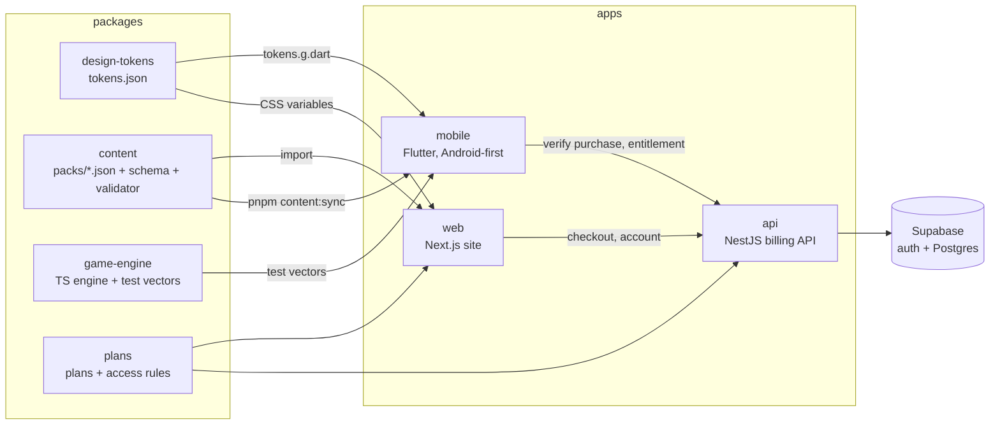

# MirthMix

Party games for one shared phone: Would You Rather, This or That, Trivia Blitz, Guess the Answer and custom party packs, for friends, couples and families playing together in person. No sign-up needed.

> **Status: Phases 1–4 of 5 are complete.** All four modes plus custom party packs are playable on Android, and in the browser at `/play` with shareable links. Premium (Google Play Billing in the app, Paddle or Dodo Payments on the web) is built and tested against fakes and a local database, but no store, provider or Supabase project is set up yet. Nothing is deployed. See [`docs/PROGRESS.md`](docs/PROGRESS.md) for exactly what works and what doesn't, and [`docs/BUILD_PROMPT.md`](docs/BUILD_PROMPT.md) for the full plan.

## Architecture



- **All game logic runs on the device.** The only backend is the billing API (`apps/api`, same design as Weblume): Google Play Billing and Paddle or Dodo Payments, verified server-side, with Supabase for purchaser sign-in and storage. Guests never touch it. See [`docs/payments-setup.md`](docs/payments-setup.md).
- **Content is data, not code.** Packs live in `packages/content/packs/`, are validated in CI and copied into the app.
- **The game engine exists in TypeScript (web) and Dart (mobile).** The TypeScript engine generates test vectors that the Dart tests replay, so the two can't drift apart.

```
apps/
  mobile/              Flutter app (see apps/mobile/README.md)
  web/                 Next.js 16 site, web player, Premium and account pages
  api/                 NestJS 12 billing API: purchaser accounts, Play Billing, Paddle/Dodo, entitlements
packages/
  design-tokens/       tokens.json → CSS variables, TS object, Dart constants; WCAG contrast tests
  content/             starter packs, zod schema, generated JSON Schema, validator, sync script
  game-engine/         seeded shuffle + Would You Rather reducer; generates test-vectors/*.json
  plans/               plan config (free / premium), indicative prices, subscription access rules
supabase/              migrations (schema source of truth) and RLS tests
scripts/               db-verify.sh (migrations + RLS on plain Postgres), db-test-setup.sh (API e2e DB)
docs/                  BUILD_PROMPT, PROGRESS, DECISIONS, QA checklist, brand assets
```

## Prerequisites

| Tool     | Version                                                           |
| -------- | ----------------------------------------------------------------- |
| Node.js  | 22 LTS (`.nvmrc`)                                                 |
| pnpm     | 10 (`corepack enable` picks up the pinned version)                |
| Flutter  | 3.47 stable (Dart 3.13)                                           |
| Android  | Android SDK + Java 17 for APK builds                              |
| Postgres | 17 with `psql`, for the database tests (optional; Docker is fine) |

## Setup

```bash
pnpm install
pnpm --filter "./packages/*" run build   # tokens, content and engine dist/ are used by the web app
cd apps/mobile && flutter pub get
```

## Commands

| Command                                       | What it does                                                          |
| --------------------------------------------- | --------------------------------------------------------------------- |
| `pnpm dev:web`                                | Website at http://localhost:3000                                      |
| `pnpm dev:api`                                | Billing API at http://localhost:4000 (needs `apps/api/.env`)          |
| `pnpm db:verify`                              | Apply migrations to a throwaway database and run the RLS tests        |
| `pnpm db:test-setup`                          | Create `mirthmix_test` for the API's database e2e tests               |
| `pnpm lint` / `pnpm typecheck` / `pnpm test`  | All TypeScript packages and the website                               |
| `pnpm format` / `pnpm format:check`           | Prettier                                                              |
| `pnpm tokens`                                 | Regenerate CSS/TS/Dart design tokens after editing `tokens.json`      |
| `pnpm content:validate`                       | Validate every pack, refresh the JSON Schema, check the app's copy    |
| `pnpm content:sync`                           | Copy packs into `apps/mobile/assets/content/`                         |
| `pnpm --filter @mirthmix/game-engine vectors` | Regenerate engine test vectors after changing engine behaviour        |
| `pnpm --filter @mirthmix/web test:e2e`        | Playwright + axe tests against a production build (run `build` first) |
| `pnpm mobile:analyze` / `pnpm mobile:test`    | `flutter analyze` / `flutter test`                                    |

## Adding or editing questions

1. Edit a pack in `packages/content/packs/` (your editor autocompletes fields from `packages/content/schema/pack.schema.json`). Ids follow `wyr-<category>-NNN` and must never be reused.
2. `pnpm content:validate`. It checks the shape, text lengths, unknown or empty categories, duplicate ids and duplicate questions (even with options swapped).
3. `pnpm content:sync`, then commit both the pack and `apps/mobile/assets/content/`.

New categories need `tier` (`free` / `premium`), `ageRating` (`all` / `13+`), `region` (`global` / `in`) and, for sensitive themes, a `contentNote` that players see before choosing it. All content must be original.

## Environment variables

| App    | Variable                                                                               | Purpose                                                                 |
| ------ | -------------------------------------------------------------------------------------- | ----------------------------------------------------------------------- |
| web    | `NEXT_PUBLIC_SITE_URL`                                                                 | Canonical URLs, sitemap and robots (default `https://mirthmix.example`) |
| web    | `NEXT_PUBLIC_API_URL`                                                                  | Billing API origin (default `http://localhost:4000`)                    |
| web    | `NEXT_PUBLIC_SUPABASE_URL`, `NEXT_PUBLIC_SUPABASE_PUBLISHABLE_KEY`                     | Purchaser sign-in; without them the Account page says it's unavailable  |
| web    | `NEXT_PUBLIC_PADDLE_CLIENT_TOKEN`, `NEXT_PUBLIC_PADDLE_ENV`                            | Paddle.js on `/checkout/paddle`                                         |
| api    | see `apps/api/.env.example`                                                            | Database, Supabase, billing providers, kill switch behaviour            |
| mobile | `--dart-define` `API_BASE_URL`, `SUPABASE_URL`, `SUPABASE_PUBLISHABLE_KEY`, `SITE_URL` | Premium and sign-in; without them the app is free-only                  |

`.env.example` files contain placeholders only; never commit real values.

## Testing

- **TypeScript:** Vitest for tokens (contrast), content (validator and shipped packs) and the engine (rules + vectors).
- **Flutter:** unit tests for the engine, content parsing and the shared vectors; widget tests for complete game flows, quitting, persistence across a relaunch, setup rules, settings and accessibility guidelines.
- **Web:** Playwright on desktop, mobile and dark mode, with axe (WCAG 2.2 AA) on every page.
- **API:** Vitest unit tests (webhook signatures, provider mapping, Play client, RTDN verification, env) and in-process HTTP tests (auth, rate limits, health); with `TEST_DATABASE_URL` set (CI does), database e2e tests cover checkout, webhooks, idempotency, out-of-order events, Play verify/acknowledge/RTDN, entitlements, the kill switch, account deletion and payload purging. `pnpm db:verify` checks the migration and row-level security.
- **Entitlements in the app:** widget tests with a fake API, store and sign-in cover free vs premium, the offline grace window, revocation by the server, purchase success/rejection/cancel and account deletion.
- **Manual:** [`docs/qa-checklist.md`](docs/qa-checklist.md).

CI (`.github/workflows/ci.yml`) runs all of the above plus an Android release APK build.

## Deployment

Nothing is deployed yet. The CI workflow deploys from `main` only after you approve each target: backend (Supabase migrations + API on Fly.io), website (Vercel) and Android (Google Play). Every target is off until its accounts and secrets exist. Setup and rollback: [`docs/deployment.md`](docs/deployment.md).

- **Website:** any Next.js host (e.g. Vercel's free tier). Set the `NEXT_PUBLIC_*` variables above. Every page is static.
- **API:** any Node 22 host (Fly.io, Render, a small VM): `pnpm --filter @mirthmix/api build && node apps/api/dist/main.js`, with the env from `apps/api/.env.example`, `TRUST_PROXY_HOPS` set behind a proxy, liveness `/health` and readiness `/ready`. Database and auth: a Supabase project with `supabase/migrations` applied. Full steps in `docs/payments-setup.md`.
- **Android:** build an app bundle signed with the upload key (see `apps/mobile/README.md`). New personal Play Console accounts must run a closed test with at least 12 testers for 14 consecutive days before production access.

## Troubleshooting

- **`apps/mobile/assets/content/... is stale`:** run `pnpm content:sync`.
- **`tokens.g.dart is stale`:** run `pnpm tokens`.
- **`test-vectors are stale`:** engine behaviour changed. If intended, regenerate with `pnpm --filter @mirthmix/game-engine vectors` and make the Dart engine match (`flutter test` will tell you).
- **Web or API can't resolve `@mirthmix/*`:** build the packages first (`pnpm --filter "./packages/*" run build`).
- **API database tests are skipped:** set `TEST_DATABASE_URL` after `pnpm db:test-setup` (e.g. `docker run -e POSTGRES_PASSWORD=postgres -p 5432:5432 postgres:17`).
