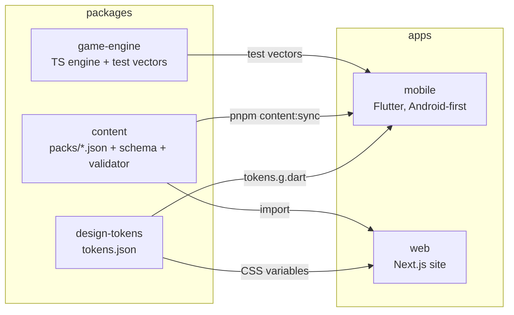

# MirthMix

Party games for one shared phone: Would You Rather, This or That, Trivia Blitz, Guess the Answer and custom party packs, for friends, couples and families playing together in person. No sign-up needed.

> **Status: Phases 1–3 of 5 are complete.** All four modes plus custom party packs are playable on Android, and in the browser at `/play` with shareable links. Nothing is deployed. See [`docs/PROGRESS.md`](docs/PROGRESS.md) for exactly what works and what doesn't, and [`docs/BUILD_PROMPT.md`](docs/BUILD_PROMPT.md) for the full plan.

## Architecture



- **All game logic runs on the device.** There is no backend in Phase 1. A NestJS billing API and Supabase arrive in Phase 4 (same design as Weblume: Google Play Billing + Paddle or Dodo Payments, verified server-side).
- **Content is data, not code.** Packs live in `packages/content/packs/`, are validated in CI and copied into the app.
- **The game engine exists in TypeScript (web) and Dart (mobile).** The TypeScript engine generates test vectors that the Dart tests replay, so the two can't drift apart.

```
apps/
  mobile/              Flutter app (see apps/mobile/README.md)
  web/                 Next.js 16 marketing site (web player arrives in Phase 3)
packages/
  design-tokens/       tokens.json → CSS variables, TS object, Dart constants; WCAG contrast tests
  content/             starter packs, zod schema, generated JSON Schema, validator, sync script
  game-engine/         seeded shuffle + Would You Rather reducer; generates test-vectors/*.json
docs/                  BUILD_PROMPT, PROGRESS, DECISIONS, QA checklist, brand assets
```

## Prerequisites

| Tool    | Version                                            |
| ------- | -------------------------------------------------- |
| Node.js | 22 LTS (`.nvmrc`)                                  |
| pnpm    | 10 (`corepack enable` picks up the pinned version) |
| Flutter | 3.47 stable (Dart 3.13)                            |
| Android | Android SDK + Java 17 for APK builds               |

## Setup

```bash
pnpm install
pnpm --filter "./packages/*" run build   # tokens, content and engine dist/ are used by the web app
cd apps/mobile && flutter pub get
```

## Commands

| Command                                       | What it does                                                          |
| --------------------------------------------- | --------------------------------------------------------------------- |
| `pnpm dev:web`                                | Website at http://localhost:3000                                      |
| `pnpm lint` / `pnpm typecheck` / `pnpm test`  | All TypeScript packages and the website                               |
| `pnpm format` / `pnpm format:check`           | Prettier                                                              |
| `pnpm tokens`                                 | Regenerate CSS/TS/Dart design tokens after editing `tokens.json`      |
| `pnpm content:validate`                       | Validate every pack, refresh the JSON Schema, check the app's copy    |
| `pnpm content:sync`                           | Copy packs into `apps/mobile/assets/content/`                         |
| `pnpm --filter @mirthmix/game-engine vectors` | Regenerate engine test vectors after changing engine behaviour        |
| `pnpm --filter @mirthmix/web test:e2e`        | Playwright + axe tests against a production build (run `build` first) |
| `pnpm mobile:analyze` / `pnpm mobile:test`    | `flutter analyze` / `flutter test`                                    |

## Adding or editing questions

1. Edit a pack in `packages/content/packs/` (your editor autocompletes fields from `packages/content/schema/pack.schema.json`). Ids follow `wyr-<category>-NNN` and must never be reused.
2. `pnpm content:validate`. It checks the shape, text lengths, unknown or empty categories, duplicate ids and duplicate questions (even with options swapped).
3. `pnpm content:sync`, then commit both the pack and `apps/mobile/assets/content/`.

New categories need `tier` (`free` / `premium`), `ageRating` (`all` / `13+`), `region` (`global` / `in`) and, for sensitive themes, a `contentNote` that players see before choosing it. All content must be original.

## Environment variables

| App | Variable               | Purpose                                                                 |
| --- | ---------------------- | ----------------------------------------------------------------------- |
| web | `NEXT_PUBLIC_SITE_URL` | Canonical URLs, sitemap and robots (default `https://mirthmix.example`) |

The mobile app needs no configuration in Phase 1. `.env.example` files contain placeholders only; never commit real values.

## Testing

- **TypeScript:** Vitest for tokens (contrast), content (validator and shipped packs) and the engine (rules + vectors).
- **Flutter:** unit tests for the engine, content parsing and the shared vectors; widget tests for complete game flows, quitting, persistence across a relaunch, setup rules, settings and accessibility guidelines.
- **Web:** Playwright on desktop, mobile and dark mode, with axe (WCAG 2.2 AA) on every page.
- **Manual:** [`docs/qa-checklist.md`](docs/qa-checklist.md).

CI (`.github/workflows/ci.yml`) runs all of the above plus an Android release APK build.

## Deployment

Nothing is deployed yet, and nothing should be without the owner's go-ahead.

- **Website:** any Next.js host (e.g. Vercel's free tier). Set `NEXT_PUBLIC_SITE_URL`. Every page is static.
- **Android:** build an app bundle signed with the upload key (see `apps/mobile/README.md`). New personal Play Console accounts must run a closed test with at least 12 testers for 14 consecutive days before production access.

## Troubleshooting

- **`apps/mobile/assets/content/... is stale`:** run `pnpm content:sync`.
- **`tokens.g.dart is stale`:** run `pnpm tokens`.
- **`test-vectors are stale`:** engine behaviour changed. If intended, regenerate with `pnpm --filter @mirthmix/game-engine vectors` and make the Dart engine match (`flutter test` will tell you).
- **Web can't resolve `@mirthmix/*`:** build the packages first (`pnpm --filter "./packages/*" run build`).
